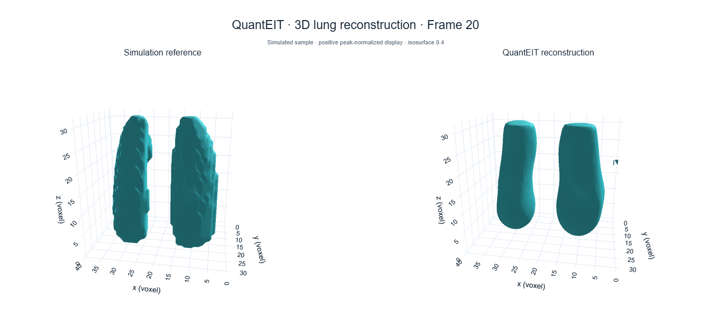

# QuantEIT: Single-Frame 3D Lung Reconstruction Demo

Run QuantEIT on one simulated 3D lung EIT sample: **frame 20** from the
authors' lung simulation. The sensing operator, voltage measurement, geometry
and reference field are included. The complete 20-frame voltage and reference
sequence is also provided for independent use. No quantum hardware or simulator is needed.

Paper: [QuantEIT: Ultra-Lightweight Quantum-Inspired Inference for Electrical
Impedance Tomography](https://ieeexplore.ieee.org/abstract/document/11718876),
IEEE Transactions on Industrial Informatics, 2026.

[中文说明](README_zh.md) · [Data format](data/README.md)



## Run the demo

Use Python 3.10 or newer. Open a terminal in this repository's root directory:

```bash
python -m pip install -r requirements.txt
python run_demo.py
```

This reconstructs **only frame 20**, using 1000 Adam iterations. CUDA is selected
when available; otherwise the program uses the CPU. The reference field is
used after reconstruction for metrics and visualization, not in the loss.

Open `results/viewer_3d.html` in a browser to rotate and zoom the reconstruction.
It works offline. Other outputs are:

- `reconstruction.npz`: signed FEM coefficients and the 3D volume.
- `summary.png` and `projections.png`: reference/reconstruction comparisons.
- `metrics.csv`: G-SSIM, RIE, CC, PSNR and the measurement residual.
- `run.json`: configuration and run information.

The default 3D display threshold is 0.4 of the positive peak. Changing it
affects the displayed surface, not the reconstruction values or metrics.
The current parameters are in `configs/default.json`.

## View the included result without fitting

Open `examples/viewer_3d.html` directly, or regenerate the figures:

```bash
python -m pip install -r requirements-visualization.txt
python visualize.py
```

This visualization-only command does not require PyTorch or a GPU.

## Useful commands

```bash
# Explicit CPU execution.
python run_demo.py --device cpu --output results/cpu

# Quick installation check; 10 iterations do not produce a converged result.
python run_demo.py --epochs 10 --output results/smoke

# Render an existing result at a different display threshold.
python visualize.py --result results/reconstruction.npz --threshold 0.5 --output results/view05

# Check the implementation and supplied data.
python -m unittest discover -s tests -v
```

Existing reconstruction files are not overwritten. Use a fresh `--output`
directory when running again. CPU execution takes longer than CUDA.

## Use the complete 20-frame dataset

The default demo still reconstructs only frame 20. The complete sequence is
available separately in `data/measurements_20frames.npz` and
`data/ground_truth_20frames.npz`, with frame IDs 1 through 20 in matching order:

```python
import numpy as np

with np.load("data/measurements_20frames.npz", allow_pickle=False) as data:
    voltages = data["voltages"]          # float32, shape (20, 328)
    frame_ids = data["frame_ids"]        # 1, 2, ..., 20
with np.load("data/ground_truth_20frames.npz", allow_pickle=False) as data:
    references = data["conductivity_changes"]  # float32, shape (20, 28153)
    assert np.array_equal(frame_ids, data["frame_ids"])
```

All frames use the included operator and geometry. Pass `voltages[i]` to
`Reconstructor.reconstruct`; map `references[i]` to a 3D reference volume with
`dataset.to_volume`. These are simulated conductivity-change fields, not
patient recordings. See [data/README.md](data/README.md) for ordering and format.

## Use the reconstruction code

The main implementation is in `quanteit_lung/reconstruction.py`. It fits the
QuantEIT representation to the voltage measurements using MSE, 3D TV,
Laplacian and L1 terms. A measurement vector can be reconstructed directly:

```python
import numpy as np
from quanteit_lung.data import load_dataset
from quanteit_lung.reconstruction import Reconstructor

dataset = load_dataset()
engine = Reconstructor(dataset, device="auto")
coefficients, info = engine.reconstruct(dataset.voltages[0])
volume = dataset.to_volume(coefficients)  # shape: (z, y, x)
np.save("my_reconstruction.npy", volume)
```

To use another measurement with the same operator, replace `dataset.voltages[0]`
with a float32 vector of shape `(328,)`. Its normalization and measurement
ordering must match the operator. For another geometry, supply a consistent
sensitivity matrix, measurements and FEM-to-volume map; see [data/README.md](data/README.md).
Reference fields are not required by `Reconstructor`.

The supplied operator has shape `(328, 28153)` and the volume grid is
`(32, 32, 40)` in **z, y, x** order. The included sample is simulated data.
More implementation details are in [REPRODUCIBILITY.md](REPRODUCIBILITY.md).

## Citation and license

If you use this code or the QuantEIT method in your work, please cite
H. Fang, S. Teng, H. Yu, Z. Liu, S. Yuan, H. He, and Y. Yang,
"QuantEIT: Ultra-Lightweight Quantum-Inspired Inference for Electrical Impedance
Tomography," IEEE Transactions on Industrial Informatics, early access,
pp. 1–12, 2026.
DOI: [10.1109/TII.2026.3731100](https://doi.org/10.1109/TII.2026.3731100).

```bibtex
@article{fang2026quanteit,
  author = {Fang, Hao and Teng, Sihao and Yu, Hao and Liu, Zhe and
            Yuan, Siyi and He, Huaiwu and Yang, Yunjie},
  title = {{QuantEIT}: Ultra-Lightweight Quantum-Inspired Inference for
           Electrical Impedance Tomography},
  journal = {IEEE Transactions on Industrial Informatics},
  year = {2026},
  pages = {1--12},
  doi = {10.1109/TII.2026.3731100},
  url = {https://ieeexplore.ieee.org/abstract/document/11718876}
}
```

GitHub's **Cite this repository** entry uses `CITATION.cff`, whose preferred
citation is the paper above. A copy of the BibTeX entry is in `citation.bib`.

Code, the included simulated sample and generated examples use the [MIT license](LICENSE).
